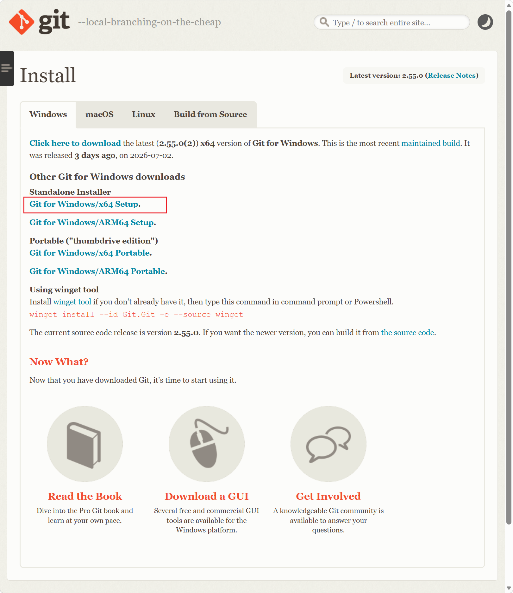
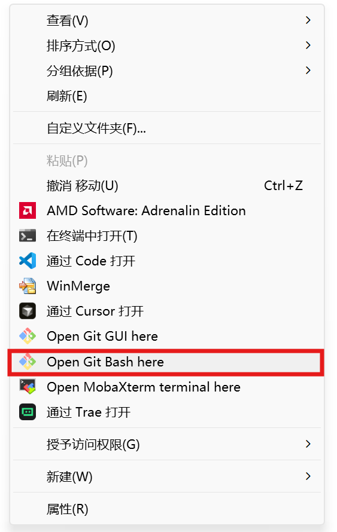
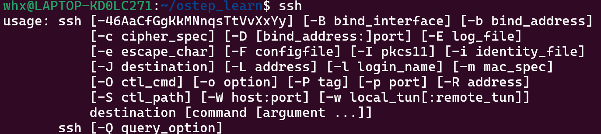
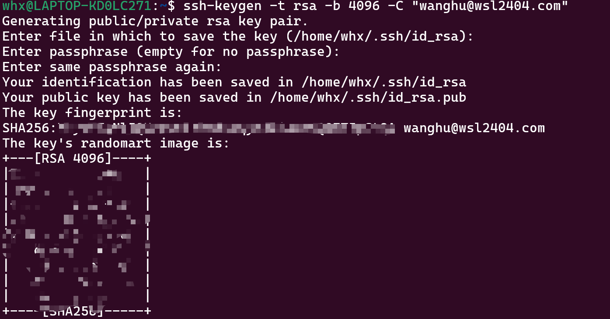
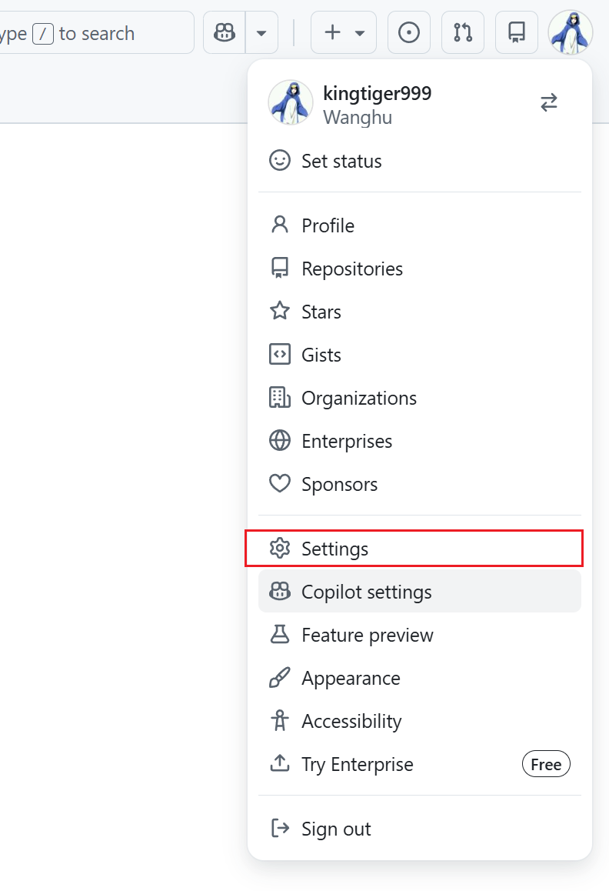
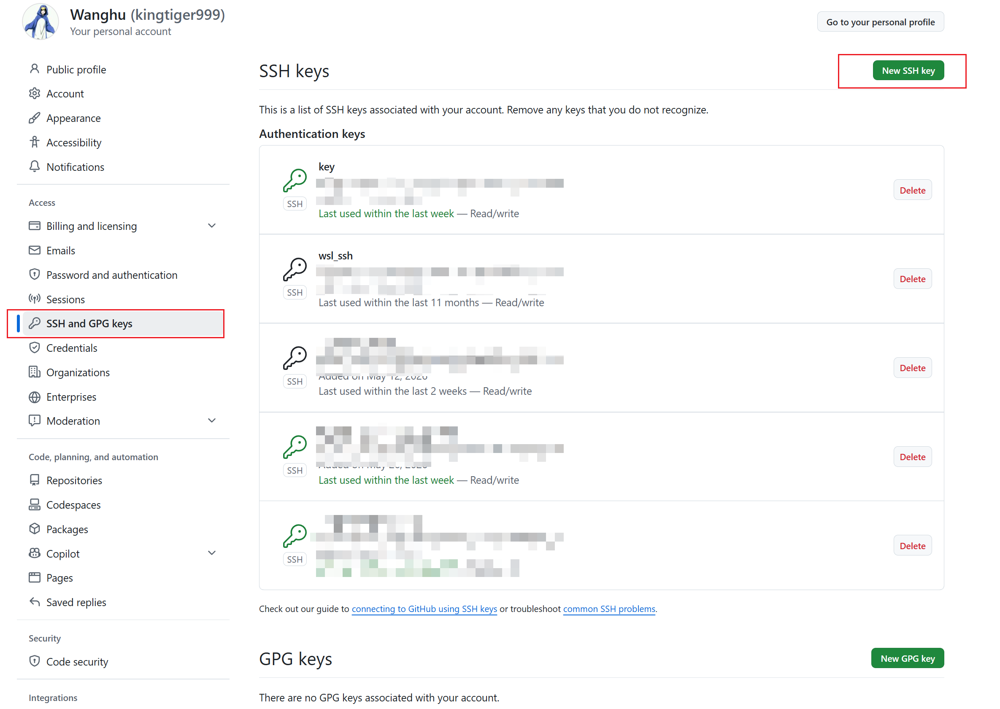
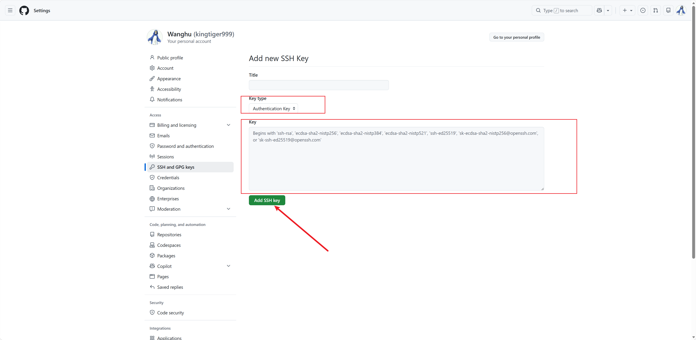
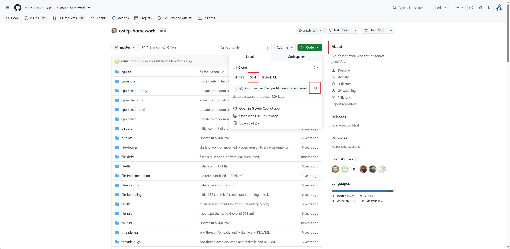

# Git安装
Linux / WSL 下安装 git 指令：

```shell
sudo apt update
sudo apt upgrade
sudo apt install git
```

windows 下安装 git，根据自己电脑架构选择，下载 git 软件，并运行按照提示安装即可

[https://git-scm.com/install/windows](https://git-scm.com/install/windows)



# Git环境配置
## 基本配置
Linux / WSL 下直接在终端中配置，windows下可以进入右键进入到 Git Bash中进行配置，如图所示



```shell
# 配置用户名邮箱
git config --global user.name "Your Name"
git config --global user.email "your.email@xxx.com"

# 行尾处理（避免跨平台换行问题）
git config --global core.autocrlf input

# 忽略文件权限变化（适用于 WSL）
git config --global core.filemode false

# 默认分支命名为 main
git config --global init.defaultBranch main

# 启用彩色输出
git config --global color.ui auto

# 将 /data 加入安全目录（避免 detached HEAD 警告）
git config --global --add safe.directory /data
```

## SSH远程配置
配置SSH远程连接 github

1. 安装 ssh，默认情况下 win10、win11中 ssh 是直接可以运行的，WSL / Ubuntu下安装指令

```shell
sudo apt install openssh-server openssh-client
```

2. 查看是否安装成功，如下图安装成功后会显示 ssh 相关指令

```shell
ssh
```



3. ssh生成公钥和私钥

```shell
ssh-keygen -t rsa -b 4096 -C "your_email@example.com"
```

生成过程中直接回车即可，不需要设置相关密码



4. 将公钥配置到 github 网站中

复制公钥

```shell
cat ~/.ssh/id_rsa.pub
```


设置到 github 中

登录到github后，点击 Settings 进入到设置



点击 SSH and GPG keys，并点击New SSH key



将复制的公钥填入到 Key 中，并点击Add SSH key即可




1. 后续下载 github 中项目即可通过 ssh 方式进行下载

例如



```shell
git clone git@github.com:remzi-arpacidusseau/ostep-homework.git
```


# Git 基本使用
正在更新中......

